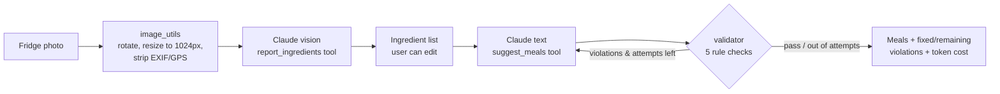

# Architecture



1. **`POST /api/detect`**: the photo is preprocessed (rotation fixed, longest edge resized to `MAX_IMAGE_EDGE`, metadata removed) and sent to a multimodal Claude model. The model has to answer through a forced tool call (`report_ingredients`), which means it always returns structured JSON: name, quantity, confidence, and an expiring flag.
2. The user reviews and edits the list. Detection is never perfect, so a person checks it before anything else happens.
3. **`POST /api/generate`**: the ingredients, appliances, ranked priorities, time limit, and allergies go to the model through a second forced tool call (`suggest_meals`).
4. **Validator** (our rule engine, `validator.py`): every meal goes through five checks:

   | Rule | What it catches |
   |---|---|
   | `unknown_ingredient` | Ingredient not in the fridge list or the pantry basics (`catalog.ALLOWED_BASICS`) |
   | `equipment` | Appliance the student doesn't own, either declared in `appliances_used` or hidden in the step text ("preheat the oven", "in a skillet") |
   | `prep_time` | Over the time limit |
   | `food_safety` | Raw eggs, meat, or fish with no cook-through instruction ("until fully set", "165F", …) |
   | `schema` | Malformed meal, or a meal with no steps or ingredients |

5. **Retry loop** (`pipeline.py`): if any rule fails, the exact violations are sent back to the model as feedback, up to `MAX_GENERATION_ATTEMPTS` times. The response reports `first_try_valid`, `violations_fixed`, `remaining_violations`, and token usage with an estimated cost. These are the numbers used in the evaluation.

## What is ours vs. the AI API
The Claude API does the vision recognition and writes the recipe text. Our team built:
- the prompts and JSON tool schemas (`prompts.py`)
- image preprocessing and privacy handling
- the constraint validator: ingredient name normalization, plural and synonym handling, whole-word equipment detection (so "eggplant" isn't read as "egg" and "microwave oven" isn't read as an oven), and the food-safety rule
- the feedback/retry loop
- cost tracking
- mock mode
- the detection evaluation script

## API

The website is served at `/`. Interactive API docs are at `/docs` when the server is running.

| Method | Path | Body | Returns |
|---|---|---|---|
| GET | `/api/health` | | `status`, `mock_mode`, `model` |
| GET | `/api/options` | | `{"appliances": {key: label}, "priorities": {key: label}}` |
| POST | `/api/detect` | multipart `photo` (JPEG/PNG/WebP, ≤10 MB) | `ingredients[]`, `usage`, `mock` |
| POST | `/api/generate` | JSON `GenerateRequest` (see below) | `meals[]`, `attempts`, `first_try_valid`, `violations_fixed[]`, `remaining_violations[]`, `usage`, `mock` |

```bash
curl -F "photo=@data/photos/fridge_007.jpg" http://127.0.0.1:8000/api/detect

curl -X POST http://127.0.0.1:8000/api/generate -H "Content-Type: application/json" -d '{
  "ingredients": [{"name": "eggs"}, {"name": "spinach", "expiring": true}, {"name": "cheddar cheese"}],
  "appliances": ["microwave"],
  "priorities": ["use_expiring", "speed"],
  "max_prep_minutes": 15,
  "allergies": ""
}'
```
`priorities` are ranked, most important first, from `speed`, `healthy`, `filling`, `use_expiring`.
`appliances` come from `microwave`, `electric_kettle`, `rice_cooker`, `toaster`, `air_fryer`, `hot_plate`.
To get different meals, send the earlier names in `exclude_meals`.

## Configuration (`.env`)

| Variable | Default | Meaning |
|---|---|---|
| `ANTHROPIC_API_KEY` | *(blank)* | Blank means mock mode |
| `ANTHROPIC_MODEL` | `claude-haiku-4-5` | Model used for both detection and meals |
| `MOCK_MODE` | `0` | `1` forces mock mode even with a key |
| `MAX_IMAGE_EDGE` | `1024` | Photo resize limit (px) |
| `MAX_GENERATION_ATTEMPTS` | `2` | 1 = no retry |
| `PRICE_INPUT_PER_MTOK` / `PRICE_OUTPUT_PER_MTOK` | `1.0` / `5.0` | USD per million tokens, used for the cost estimate |

## Project layout

```
backend/app/
  main.py          FastAPI app: /api routes, upload checks, error codes, serves frontend/
  config.py        settings from environment / .env
  schemas.py       Pydantic request/response models
  catalog.py       appliances, priorities, pantry basics, equipment + safety keywords
  image_utils.py   photo preprocessing (rotate, resize, strip metadata)
  prompts.py       system prompts + JSON tool schemas for both model calls
  llm.py           AnthropicClient (real) and MockClient (offline), same interface
  validator.py     rule checks on generated meals + ingredient-name normalization
  pipeline.py      generate -> validate -> retry loop
scripts/
  run_sample.py      full photo-to-meals flow on one photo, no server
  eval_detection.py  detection precision/recall/F1 vs. ground truth
eval/ground_truth.json   hand labels for data/photos/
data/photos/             test photos (Wikimedia Commons, see SOURCES.md)
frontend/                website (plain HTML/CSS/JS), served at /
tests/                   pytest suite (mock mode)
docs/                    this file + prompts.md
```
